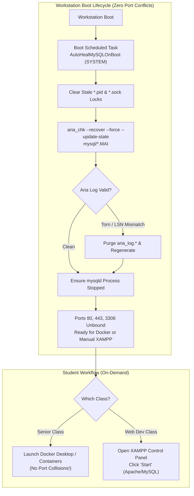

# 07 - XAMPP, MariaDB Sudden Shutdown Hardening & Zeal Documentation Snapin

## Overview
This snapin provisions a fully automated, machine-wide installation of **XAMPP 8.2** (Apache, MariaDB/MySQL, PHP, phpMyAdmin) and **Zeal Documentation Reader v0.9.1** with preloaded **MySQL offline documentation** on Windows lab workstations via FOG Project.

Crucially, this snapin addresses and eliminates the notorious **MariaDB/MySQL corruption failure** that plagues shared academic computer labs, where workstations are frequently subjected to sudden power loss, hard reboots, and power strip cutoffs without a graceful Windows shutdown.

> [!IMPORTANT]
> **Docker & Senior Class Coexistence (Zero Port Conflicts)**:
> By strict design, this snapin **DOES NOT install or run Apache, MariaDB, or phpMyAdmin as automatic background Windows Services**.
> - Workstations boot up with **ports `80`, `443`, and `3306` completely unbound and free** so senior classes can run **Docker containers** without port collisions.
> - Students who need XAMPP simply launch it on-demand from the desktop shortcut (**XAMPP Control Panel**) and click "Start".
> - An offline boot-time self-healing task runs in seconds before user login to verify/repair database files, leaving all daemons stopped and all ports free.

---

## The Root Cause: Why Default XAMPP MySQL Corrupts on Sudden Shutdown

In shared computer labs, administrators often find that after an abrupt power loss or hard reboot, XAMPP's MySQL service refuses to start with errors such as:
* `[ERROR] mysqld.exe: Aria engine: log sequence number ... is invalid`
* `[ERROR] Plugin 'Aria' init function returned error.`
* `[ERROR] Plugin 'Aria' registration as a STORAGE ENGINE failed.`
* `[ERROR] mysqld.exe: Table '.\mysql\global_priv' is marked as crashed and should be repaired`
* `[ERROR] Failed to open the relay log / Could not open log file`

### Why Traditional Internet Advice Fails:
1. **"Delete `aria_log.*` and `aria_log_control`"**: 
   While deleting these control files allows the Aria plugin to initialize, MariaDB 10.4+ stores critical system tables (`mysql.global_priv`, `mysql.tables_priv`, etc.) in the Aria storage engine (`*.MAI` and `*.MAD` files). When an abrupt shutdown occurs, the internal "in use / dirty / crashed" bit in the `.MAI` table header remains set. MariaDB detects this state on startup and halts immediately, refusing to boot unless tables are formally repaired with `aria_chk`.
2. **"Delete `ibdata1`"**: 
   Deleting `ibdata1` is catastrophic. `ibdata1` houses InnoDB's system data dictionary, undo logs, and rollback segments. Deleting it destroys the metadata binding for all existing InnoDB user databases, permanently orphaning `.ibd` files and triggering `Tablespace id ... does not match the tablespace id recorded in the data dictionary` errors.
3. **Corrupted Binary Log Indexes (`mysql-bin.index`)**:
   When binary logging is enabled without active disk synchronization, hard power loss tears the binlog index, causing MariaDB to refuse to bind or start.

---

## Architectural Hardening Strategy



### 1. Complete Hard-Shutdown Protection Flags in `my.ini`
The deployment script injects an exhaustive suite of crash-durability directives into `C:\xampp\mysql\bin\my.ini`:

| Directive | Configured Value | Engineering Impact & Crash Protection |
| :--- | :--- | :--- |
| **`skip-log-bin`** | *(Flag enabled)* | **Binary Log Protection**: Completely disables replication binary logging. Eliminates corrupt `mysql-bin.index` or half-written binlog crashes upon sudden power loss. |
| **`aria_recover_options`** | `BACKUP,QUICK,FORCE` | **Aria Engine Auto-Recovery**: Forces MariaDB to automatically recover and repair dirty/crashed system tables (`mysql.global_priv`) on startup instead of halting. |
| **`aria_log_purge_type`** | `immediate` | Actively purges committed transaction logs to prevent stale log backlogs and speed up crash recovery. |
| **`aria_sync_log_dir`** | `ALWAYS` | **NTFS Directory Sync**: Forces directory entry metadata for Aria logs to be synchronized to disk immediately, preventing missing or orphan log file references. |
| **`aria_pagecache_buffer_size`**| `64M` | Dedicated cache for system privilege tables, ensuring stability under heavy concurrent student queries. |
| **`myisam_recover_options`** | `BACKUP,QUICK,FORCE` | **MyISAM Auto-Recovery**: Automatically recovers legacy or auxiliary MyISAM tables if left in a dirty state. |
| **`innodb_flush_log_at_trx_commit`** | `1` | **Strict ACID Durability**: Redo log buffer is written and flushed to disk on every transaction commit, preventing data loss. |
| **`innodb_doublewrite`** | `1` | **Torn Page Protection**: Pages are written first to the doublewrite buffer before tablespace files; if power is cut mid-write, InnoDB restores torn pages from the buffer. |
| **`innodb_checksum_algorithm`** | `full_crc32` | Hardware-accelerated CRC32 checksums ensure corrupted blocks are detected immediately and repaired via the doublewrite buffer. |
| **`innodb_file_per_table`** | `1` | Isolates each table into its own `.ibd` file, preventing individual table crashes from destabilizing the central `ibdata1` tablespace. |
| **`innodb_adaptive_flushing`** | `1` | Dynamically flushes dirty pages in the background based on workload, keeping the dirty page count low before sudden power cuts. |
| **`innodb_max_dirty_pages_pct`**| `50` | Caps dirty pages in the buffer pool at 50% (down from 75%), reducing unwritten disk backlog during abrupt power interruptions. |
| **`innodb_buffer_pool_size`** | `256M` | Allocates sufficient memory for responsive student database operations without starving host RAM. |
| **`innodb_log_buffer_size`** | `16M` | Generous redo log buffer to prevent transaction stalls. |
| **`innodb_autoextend_increment`**| `64` | Expands tablespaces in 64 MB increments, minimizing fragmentation and disk allocation overhead. |
| **`innodb_flush_method`** | `normal` | Standard Windows buffered I/O with explicit flush handles. |
| **`innodb_fast_shutdown`** | `0` | Forces InnoDB to perform a complete buffer pool purge and change buffer merge whenever a shutdown signal is received. |

---

### 2. Automated Offline Boot-Time Self-Healing Task
Even with the best settings, a physical power cutoff during an active write cycle can leave dirty filesystem flags. The snapin deploys [AutoHeal-MySQL.ps1](AutoHeal-MySQL.ps1) and registers a native Windows Scheduled Task (**`AutoHealMySQLOnBoot`**):
* **Execution Context:** Runs under `NT AUTHORITY\SYSTEM` at system cold boot / reboot.
* **Pure Offline Operation:** Scans and repairs files on disk, then ensures `mysqld.exe` is completely stopped. **Leaves all ports (3306, 80, 443) completely free for Docker.**
* **Stale PID & Socket Clearing:** Deletes lingering `*.pid` and `*.sock` files that prevent MySQL from starting after an abrupt power loss.
* **Aria Table Re-indexing:** Executes `aria_chk.exe --silent --recover --force --update-state` across all `C:\xampp\mysql\data\mysql\*.MAI` tables, clearing crash flags and repairing index blocks in milliseconds.
* **Aria Log Resync:** Tests MariaDB plugin initialization; if an unrecoverable LSN log mismatch is detected, it cleanly purges corrupted `aria_log.*` and `aria_log_control` files, allowing MariaDB to regenerate fresh log sequences automatically.
* **System DB Golden Fallback:** Maintains an untouched golden backup in `C:\xampp\mysql\backup_system_pristine`. If system tables are missing, it restores them without modifying student databases.

---

### 3. Pre-Staged `xampp-control.ini` (Streamlined UX)
Pre-configures `C:\xampp\xampp-control.ini` to eliminate user friction:
* Sets `Language=en` (suppresses the first-launch English/German prompt).
* Hides unused modules (`TomcatVisible=0`, `MercuryVisible=0`, `FileZillaVisible=0`).
* Enforces `Autostart=0` and `Services=0` across all modules so nothing starts unexpectedly.

---

### 4. Multi-User ACL Configuration (`C:\xampp` for All Users)
By default, Windows restricts standard non-administrator users to Read & Execute in root drive folders. The script recursively grants `Modify` permissions using language-independent SIDs:
* `*S-1-5-32-545` (`BUILTIN\Users`)
* `*S-1-5-11` (`NT AUTHORITY\Authenticated Users`)

Ensures standard student accounts can:
* Write and edit PHP projects in `C:\xampp\htdocs`.
* Permit MariaDB and Apache to write runtime data and logs (`C:\xampp\mysql\data`, `C:\xampp\apache\logs`, `C:\xampp\tmp`).
* Save preferences in `C:\xampp\xampp-control.ini`.

---

## Zeal Documentation Reader & Preloaded MySQL Docset

**Zeal** is an offline documentation browser inspired by Dash, enabling students to search documentation instantly without requiring active internet access.

### Preloading Architecture:
1. **Silent MSI Deployment:** Installs `zeal-0.9.1-windows-x64.msi` machine-wide to `C:\Program Files\Zeal`.
2. **Offline Docset Extraction:** The snapin bundles `MySQL.tgz` (official Kapeli/Dash MySQL docset). During deployment, native `tar.exe` extracts it directly into `C:\ProgramData\Zeal\docsets\MySQL.docset` in ~2 seconds.
3. **Machine-Wide Registry & Default User Hive Provisioning:**
   * Configures `HKLM:\Software\Zeal\Zeal\docsets\path` = `C:/ProgramData/Zeal/docsets`.
   * Mounts `C:\Users\Default\NTUSER.DAT` into `HKU\TempDefault`, configures the docset path, and unloads the hive so **every newly logging-on student automatically inherits the configured path**.
   * Creates a directory junction from `C:\Users\Default\AppData\Local\Zeal\Zeal\docsets` to `C:\ProgramData\Zeal\docsets` as a failsafe.

---

## Public Desktop Shortcuts

The snapin provisions three convenient shortcuts on `C:\Users\Public\Desktop` for all users:
1. **XAMPP Control Panel:** Direct access to `C:\xampp\xampp-control.exe` (students click Start on Apache/MySQL when needed).
2. **Zeal Documentation:** Offline documentation reader preloaded with MySQL docs.
3. **Repair MySQL:** Double-clickable shortcut targeting [Repair-MySQL.bat](Repair-MySQL.bat), allowing instructors or lab assistants to trigger on-demand auto-healing with visible console feedback in seconds.

---

## Package Manifest

| File | Purpose | Size / Source |
| :--- | :--- | :--- |
| [deployXamppZeal.ps1](deployXamppZeal.ps1) | Primary unattended snapin deployment and hardening script | Master installer |
| [AutoHeal-MySQL.ps1](AutoHeal-MySQL.ps1) | Crash recovery and Aria repair engine deployed to `C:\xampp` | Boot diagnostic & repair (offline) |
| [Repair-MySQL.bat](Repair-MySQL.bat) | Elevated batch launcher for one-click manual repair | Maintenance tool |
| `xampp-windows-x64-8.2.12-0-VS16-installer.exe` | Official XAMPP 8.2 installer (Apache 2.4.58, MariaDB 10.4.32, PHP 8.2.12) | ~150 MB |
| `zeal-0.9.1-windows-x64.msi` | Official Zeal documentation reader MSI installer | ~105 MB |
| `MySQL.tgz` | Bundled offline MySQL docset (Dash/Kapeli format) | ~42 MB |

---

## FOG Snapin Deployment Configuration

Configure the snapin in the **FOG Web Management GUI**:

1. **Snapin Name:** `07_Xampp_MariaDB_Hardened_Zeal`
2. **Snapin Run With:** `powershell.exe`
3. **Snapin Run With Argument:** `-ExecutionPolicy Bypass -NoProfile -File`
4. **Snapin File:** Upload the snapin archive or select `deployXamppZeal.ps1`.
5. **Snapin Arguments:** *(Leave blank to use hardened defaults)*

### Command-Line Invocation:
```powershell
powershell.exe -ExecutionPolicy Bypass -NoProfile -File "deployXamppZeal.ps1"
```

---

## Manual Recovery & Maintenance Guide

If a student machine ever experiences abnormal database behavior:
1. Double-click the **Repair MySQL** shortcut on the desktop (or run `C:\xampp\Repair-MySQL.bat`).
2. Alternatively, run via elevated PowerShell:
   ```powershell
   & "C:\xampp\AutoHeal-MySQL.ps1" -Interactive
   ```
3. Inspect diagnostic logs anytime at `C:\xampp\mysql\autoheal.log`.

---

## Licensing Notice & Disclaimer

> [!WARNING]
> **Third-Party Software, Documentation & Docset Licensing Notice**:
> While the automation scripts ([deployXamppZeal.ps1](deployXamppZeal.ps1), [AutoHeal-MySQL.ps1](AutoHeal-MySQL.ps1), [Repair-MySQL.bat](Repair-MySQL.bat)) in this directory are licensed under the [MIT License](../LICENSE), the bundled third-party installers, documentation archives, and software binaries are **NOT** covered by the MIT license:
>
> - **MySQL Documentation (`MySQL.tgz`)**:
>   - The MySQL reference documentation text, content, and SQL reference materials are copyrighted by **Oracle Corporation and/or its affiliates** and are subject to Oracle's documentation licensing terms.
>   - The docset package structure, search index, and metadata format (`MySQL.docset`) are maintained by **Kapeli** (creator of Dash) and distributed via public feeds. The resource index files are used solely for offline educational docset browsing within compatible readers such as Zeal.
> - **XAMPP (`xampp-windows-x64-8.2.12-0-VS16-installer.exe`)**:
>   - Distributed by **Apache Friends / Bitnami**. Bundles open-source software packages under their respective upstream licenses (Apache License 2.0 for Apache HTTP Server, GNU General Public License for MariaDB, PHP License for PHP, and GNU GPL for phpMyAdmin).
> - **Zeal (`zeal-0.9.1-windows-x64.msi`)**:
>   - Zeal is open-source software licensed under the **GNU General Public License v3.0 (GPLv3)**, copyrighted by Oleg Shparber and contributors.
>
> All bundled installers and offline documentation packages are provided strictly for educational deployment and classroom lab interoperability under their respective upstream licenses.

